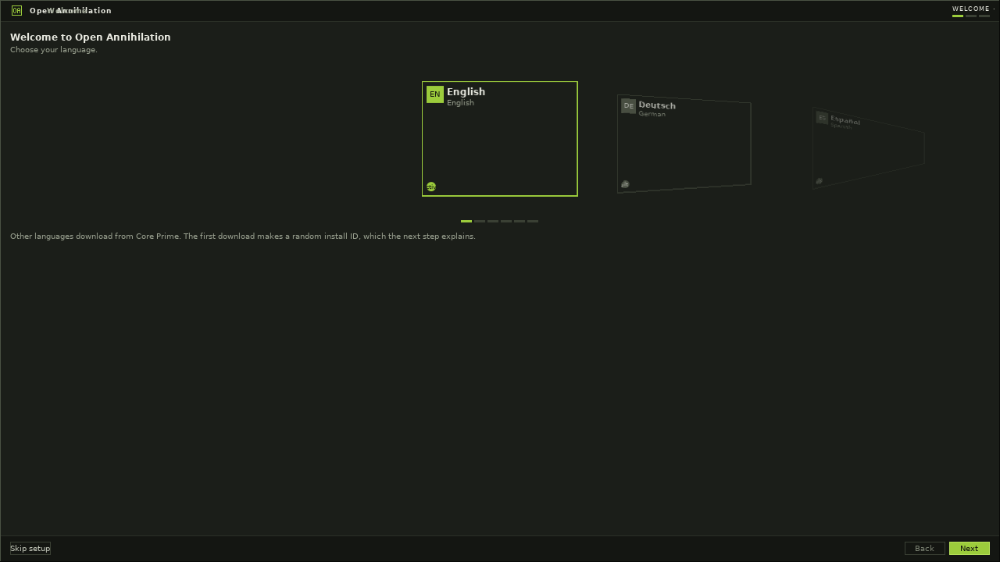
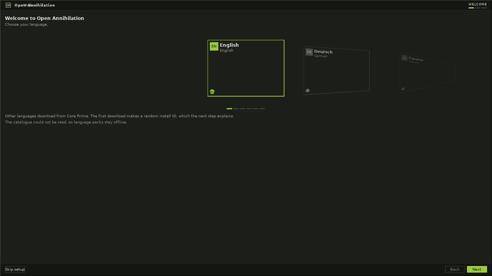
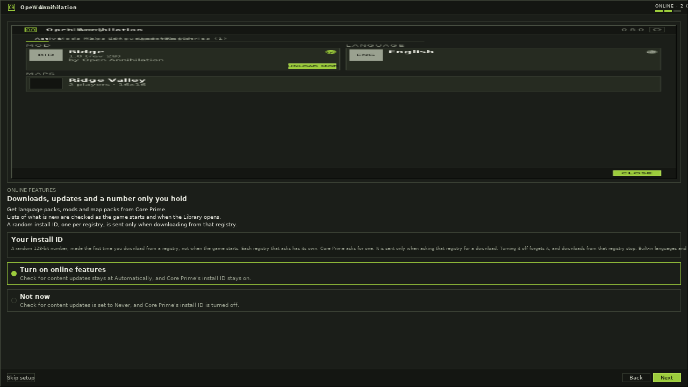
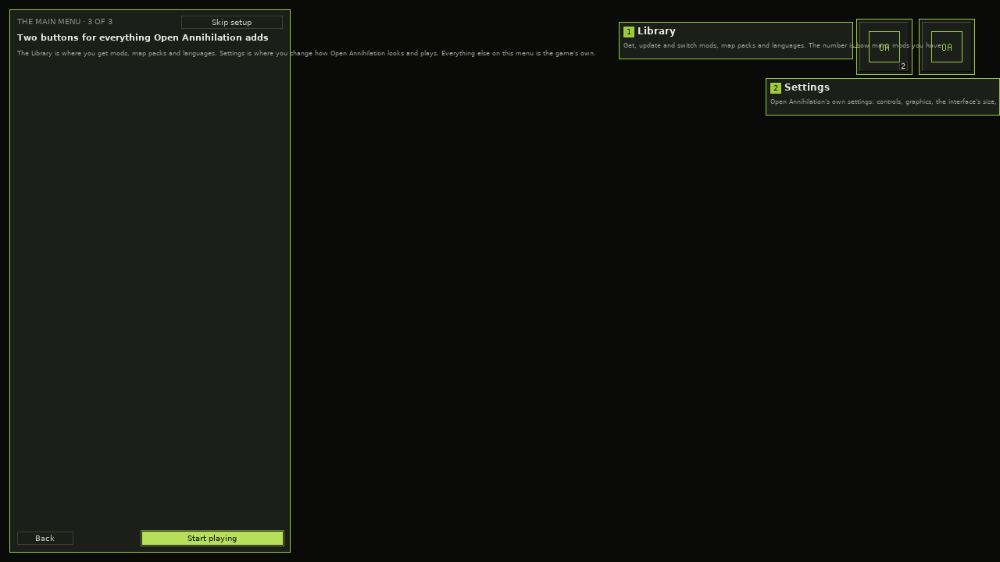

# The welcome setup

The first time the main menu is reached, after the game files are found,
Open Annihilation walks through three steps: the language, online features,
and the two buttons it adds to that menu. A player coming from 0.7 sees it
once. **Skip setup** at any step, or **Start playing** at the end, writes
`open-annihilation.first-run` as `done`, and the walk does not return.
Closing the game in the middle does not write that, so the next start
shows it again.

It stays hidden in a headless check, a benchmark, a stage run, a run
driven with `--fark`, an unattended run, and a run that names
`--preferences-file`. `--first-run` shows it anyway, including after it is
done. While it is up, or about to be, the question about a missing
language stays closed, and a language chosen here is not asked about
afterwards.

This is not the [Game files](game-files.md) screen, which brings a copy of
the game onto a phone.

## Welcome

The page word is Welcome, the step is WELCOME, and the count is 1 of 3.
The title is "Welcome to Open Annihilation" and the line under it is
"Choose your language."

The carousel lists the built-in languages in the order the game keeps them
(English, Deutsch, Español, Français, Italiano), then language packs that
are already installed, then each language pack Core Prime lists when
downloads are on and that catalogue can be read. A pack that is not
installed yet wears **Get** and its size. Choosing a built-in language, or
an installed one the game can show, switches at once and the screen is
drawn again in that language. Choosing a pack downloads it. The card says
"Downloading" and how much of the file has come. **Cancel download** stops
it. The card then says "Checking…", and the pack is installed and switched
to as soon as it is ready. A download that fails says "Couldn't download",
with the reason under the card, and **Retry**. **Next** stays available
either way, and the language stays as it was until a pack is installed.

Under the carousel, a note says that other languages download from Core
Prime and that the first download makes a random install ID, which the
next step explains. **Next** is disabled while a download is running.
Escape, and B on a controller, do nothing on this step.

## When the packs cannot be fetched

When downloads are off, or the catalogue cannot be read, the packs stay on
the carousel as **Offline** and a line under them says why: "Downloads are
off, so language packs stay offline" or "The catalogue could not be read,
so language packs stay offline." The built-in languages still switch.

## Online features

The page word is still Welcome. The step is ONLINE, 2 of 3. The picture is
the Library's Active tab, drawn live in the language just chosen, from a
fixed sample (the made-up mod Ridge). No picture of it is shipped with the
game. Under it, the kicker ONLINE FEATURES, the heading "Downloads, updates
and a number only you hold", three lines, and the install ID as
[downloads.md](downloads.md#the-install-id) describes it:

- Get language packs, mods and map packs from Core Prime.
- Lists of what is new are checked as the game starts and when the Library
  opens.
- A random install ID, one per registry, is sent only when downloading from
  that registry.

**Turn on online features** is selected to start with. **Next** then leaves
Check for content updates at Automatically and leaves Core Prime's install
ID on. It does not make an ID: the next download does.
**Not now** sets Check for content updates to Never and turns Core Prime's
install ID off, which forgets an ID a language pack made on the first
step. Built-in languages, and files you open yourself, keep working either
way.

**Back** returns to the language. Choosing again and pressing **Next**
applies the new choice. The walk is not finished until the last step, or
until **Skip setup**.

## The two buttons

This step has no setup frame. It lies over the real main menu, dimmed
except a spotlight around both buttons. Two coach marks name them:

1. **Library.** "Get, update and switch mods, map packs and languages. The
   number is how many mods you have."
2. **Settings.** "Open Annihilation's own settings: controls, graphics, the
   interface's size, downloads and your files."

The panel says "THE MAIN MENU · 3 OF 3" and "Two buttons for everything
Open Annihilation adds", then: "The Library is where you get mods, map
packs and languages. Settings is where you change how Open Annihilation
looks and plays. Everything else on this menu is the game's own."
**Back** returns to online features. **Start playing** finishes the walk.
**Skip setup** is on this step too.

## Keys and controllers

Tab and the arrows move between the controls. Enter, or A on a controller,
presses the one with the focus. Escape, or B, is **Back**, except on the
first step, where they do nothing. On the language step the shoulder
buttons and the focus keys also move the carousel.

## Showing it again

Settings › System has **Welcome setup**, with **SHOW AGAIN** and the hint
"Walk through the language, online features and the OA buttons again."
Pressing it and then **OK** clears `open-annihilation.first-run`, and the
walk shows at the next main menu, once the dialog has closed. **Cancel**
leaves the preference. During a game the row is locked, and it says
"Choose from the main menu."

## For a run that is driven

`--first-run` shows the walk even when it is already done, and even in a
run that would otherwise hide it. A stage file's line `first-run language`,
`first-run online` or `first-run buttons` opens that step for a picture. A
stage file without one of those lines does not show the walk.

The log says `first-run: showing step language` (or `online`, or
`buttons`) when the step opens, and `first-run: not showing:` with one of
`done`, `headless check`, `preferences file`, `benchmark`, `stage`,
`fark` or `unattended` when it stays hidden.

A program that presses the controls finds them as `oa.first-run.` and the
step (`language`, `online` or `buttons`) and the control. The language
cards are `oa.first-run.language.card.` and the tag in lower case, with
anything else a hyphen (`de`, `en-xa`). The rest are `skip`, `back`,
`next`, `previous`, `next-card`, `cancel` and `retry` on the language
step; `skip`, `back`, `next`, `on` and `not-now` on the online step; and
`back`, `start` and `skip` on the buttons. [automation.md](automation.md#the-welcome-setup)
lists them with the other screens.
