# Settings

Open Annihilation adds settings of its own to the game: which mod to play,
a few controls, the unit limit, the language and fonts of the game's text,
graphics and the size of Open Annihilation's own screens, touch and gamepad
controls, downloads and the registries they come from, and Developer Mode.
They live in one dialog, apart from the game's own options, which stay in
3.1c's Options menu. This page shows each section of the dialog and says
what every setting does, its default, when it takes effect and when you
might change it.

The pictures show each section at its defaults on a Mac, opened from the
main menu, with Core Prime's list of content checked a few minutes before.
The top and middle of Graphics, and Controller, are pictures from 0.7, from
before Downloads joined the column on the left.

## Contents

- [Opening the settings](#opening-the-settings)
- [OK, Cancel and Restore defaults](#ok-cancel-and-restore-defaults)
- [Mods](#mods)
- [Controls](#controls)
- [Common Tweaks](#common-tweaks)
- [Language](#language)
- [Graphics](#graphics)
- [Touch](#touch)
- [Controller](#controller)
- [Game files](#game-files)
- [Downloads](#downloads)
- [Developer](#developer)
- [For one run: the command line](#for-one-run-the-command-line)
- [Where the settings are kept](#where-the-settings-are-kept)

## Opening the settings

The settings open from:

- **SETTINGS…** at the foot of the Library, which the **OA** button at the
  bottom right of the main menu opens ([the Library](library.md));
- the **OA** button under **Resume** in the in-game menu (F2);
- **Cmd+,** on macOS, or **Settings…** in the application menu;
- **Ctrl+,** on Windows and Linux.

A game played alone stays paused while the settings are open. A
multiplayer game keeps running, and the dialog's header says so in amber:
"Shared game - still running".

The column on the left lists the sections: Mods, Controls, Common Tweaks,
Language and Graphics, then Touch while the game has touch controls,
Controller once a gamepad has been used, and Game files in the main menu
on an iPhone or an iPad, then Downloads, and Developer at its foot under a
divider. A
section taller than the dialog, such as Graphics, scrolls with the mouse
wheel, its scroll bar, Page Up, Page Down, Home and End.

A mod's own options are not here: where a mod's profile turns them on,
Ctrl+F2 in a match opens them in a dialog of their own
([ui.options-dialog](mods/standard-hacks/ui.options-dialog.md)).

## OK, Cancel and Restore defaults

Every change shows at once, so you can see what a setting does before you
keep it. A row's hint says when a setting takes effect later instead:
"Applies from the next game" or "Applies from the next start".

- **OK** (Enter) closes the dialog and keeps the changes.
- **Cancel** (Escape) closes it and puts back every setting as it was when
  the dialog opened.
- **Restore defaults** sets every setting back to its default. It leaves
  alone the mod you play, which changes only through the Mods section's
  question, the changes Developer Mode keeps for the standard hacks, and
  any setting that is locked. It also has the graphics card tried afresh (see
  [Hardware acceleration](#graphics)), turns every install ID in Downloads
  back on and sets Check for content updates to Automatically; the
  registries stay as they are. Cancel still puts everything back.

The keyboard works the whole dialog:

| Key | Does |
|---|---|
| Enter | OK |
| Escape | Cancel |
| Tab, Down | moves to the next control: the section's rows, then Restore defaults, Cancel and OK, then the sections |
| Shift+Tab, Up | moves to the previous control |
| Left, Right | turns a switch Off or On, or moves a slider, a row of choices or a drop-down one step |
| Space | flips a switch, presses a button, opens a section or a drop-down's list |
| Page Up, Page Down | scrolls the section |
| Home, End | scrolls to the section's top or end |

On a touch screen a finger takes the nearest control within reach, so a
small switch is easy to hit.

A setting that cannot change now is faded, with a padlock and the reason:

- **Locked during a game**: it can change only between games.
- **Set by the host**: a multiplayer game or a replay plays the host's
  value.
- **Set on the command line**: an option the game was started with decides
  it for this run ([below](#for-one-run-the-command-line)).
- **Not available here**: this computer or its graphics cannot offer it.
- **Needs modern fonts**: Text size, while the modern fonts are off.
- **Always on here**: Native pixel density on an iPhone or an iPad.

## Mods

Mods chooses the mod the game plays, or **No Mod** for 3.1c's own rules,
which is the default. It is a list rather than a column of settings: a row
for each mod, with its badge, its title, its version at the right and a
line that describes it. A mod without a badge shows an empty dashed square.

- **The list** starts with the mod being played, marked PLAYING, then No
  Mod when a mod is playing, then every other mod by title. It holds the
  mods in the game folder's `mods` folder and in your own Mods folder,
  `Documents/Open Annihilation/Mods`. A folder without an `oamod.yaml`
  shows its folder's name, "N/A" and "No oamod.yaml present" in amber; it
  plays with the game's own rules.
- **Choosing a mod.** A click on another row, or Space on it, asks
  **Switch Mod**: "Switch to *title* now? The game reloads its data for
  the new mod and returns to the main menu. Your other settings are kept."
  **Switch** (Enter) keeps the dialog's other changes as OK does, then
  reloads the game for that mod and returns to the main menu, without
  closing the window. **Cancel** (Escape) leaves everything as it was. The
  mod chosen is played at every later start too.
- **An update.** When a registry lists a newer release of a mod you
  installed from it, the mod's row says so in amber in place of its
  description, with the download's size: "Revision 4 available · 3.2 MB" or
  "Version 4.9 available · 41.0 MB", or "Revision 4 changes the rules ·
  3.2 MB" when the update changes the game's rules, which saved games are
  tied to, and "… may change the rules · …" when OA cannot tell. **UPDATE**,
  beside ROLL BACK, starts it. An update from Core Prime's registry starts
  at once; one from a registry you added asks first when it changes the
  rules or may change them ([which downloads ask first](library.md#which-downloads-ask-first)).
  While it downloads the line says how far it has come ("Updating · 28%"),
  and an update to the mod being played waits until you leave that mod
  ("Waiting · finishes when you leave *title*"). Nothing updates until you
  press UPDATE, here or in the [Library](library.md).
- **ROLL BACK** shows on a mod's row when its folder keeps the version an
  update replaced. It asks first (**ROLL BACK MOD**: "Roll back *title* to
  *the kept version*? *The installed version* is kept in its place, and
  ROLL BACK again brings it back.", with **CANCEL** and **ROLL BACK**); it
  swaps the two versions, and a second ROLL BACK undoes the first. For the
  mod being played it adds "The game reloads its data for the mod and
  returns to the main menu.". Rolling back an update makes that update show
  again.
- **Checked for updates 4 min ago · CHECK NOW**, under the list, says when
  the registries' lists were last checked: "Not checked for updates yet",
  "Checking for updates…", "Couldn't check for updates" in amber, or "No
  registries are on.". **CHECK NOW** checks every registry that is on, at
  once, whatever Check for content updates in [Downloads](#downloads)
  says.
- **Open Mods Folder** opens your Mods folder in the system's file manager,
  where a mod's folder goes to be listed.
- **Get More Mods…**, beside it on the main menu, opens the Library on its
  Mods tab, over the settings.

During a game the section is locked ("Locked during a game. Choose the mod
from the main menu."): a game keeps the mod it started with, and UPDATE,
CHECK NOW and GET MORE MODS… are not shown. It is locked too while
`--mod-dir` or `--base-game` chose the run's mod ("The command line chose
this run's mod.").

Change it to play a mod, or to go back to the game as 3.1c plays it.
[The Library](library.md) finds, installs and updates mods from Core
Prime's registry and those you add. [Mod support](mods/README.md) covers
[installing a mod](mods/README.md#installing-a-mod),
[installing a .oamod file](mods/README.md#installing-a-oamod-file) and
[choosing one](mods/README.md#choosing-a-mod) in full.

## Controls

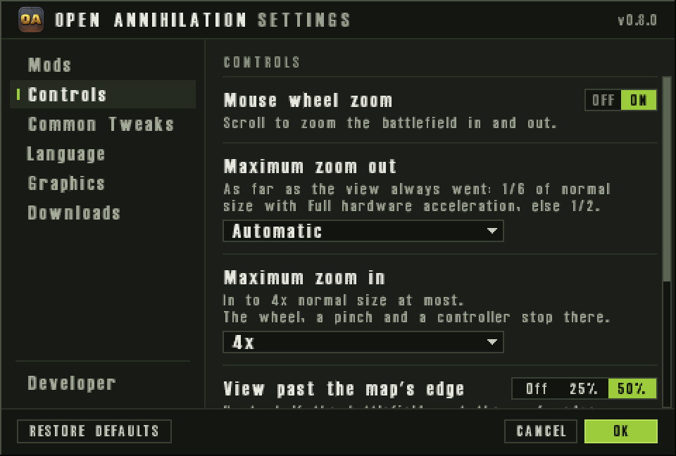

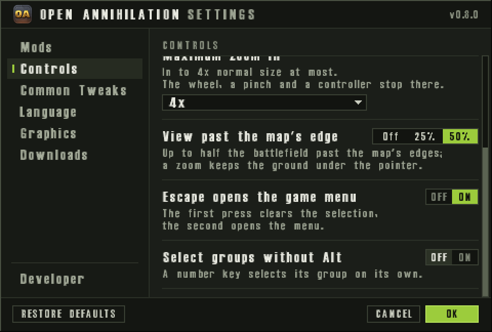

Each of these takes effect at once.

- **Mouse wheel zoom**, On by default. The mouse wheel, or a trackpad's
  scroll, zooms the battlefield in and out smoothly about the pointer: the
  ground under the pointer stays under it on every frame of the zoom, as
  the pointer moves too, so a zoom out and back in comes back to where it
  began. A zoom keeps a camera's follow of a unit (**T**, or Ctrl+C for
  the commander): it zooms about the unit at the battlefield's centre, and
  the view goes on following it; a scroll ends the follow. The view goes
  past the map's edges, by a scroll, the minimap and a zoom, as far as
  View past the map's edge lets
  it; the battlefield is black past the map, and your aircraft stay in
  view where their flight takes them past its edges. Turned off, the view eases back to the game's own scale. Turn it off if the wheel zooms when
  you do not mean it to, or to use a mod's megamap, which takes the wheel
  only while this is off
  ([ui.megamap](mods/standard-hacks/ui.megamap.md)); the wheel itself can
  zoom out to the whole map (Maximum zoom out).
- **Maximum zoom out**, Automatic, Whole map, 1/32, 1/16, 1/8, 1/4 or 1/2,
  Automatic by default. How far out the wheel, a pinch, the touch zoom
  buttons and a controller zoom the battlefield. Automatic goes as far as
  the units are drawn whole, as the view always has: half the game's scale,
  or a sixth while Full hardware acceleration draws the battlefield. Whole
  map zooms out until the whole map fits the battlefield, filling it one
  way and fitting within it the other; each fraction zooms out to that
  share of the game's scale, or
  to the whole map if it fits first. Farther out than Automatic, the
  processor draws the battlefield in every tier, its terrain reduced so
  that it takes no longer than at half scale, and the units as Zoomed out
  units, in Graphics, says: as models, or as dots past After zoom. The fog
  grows with the map: on the largest maps, with Hardware acceleration Off,
  it can make a frame of the whole map up to about twice as long as one at
  half scale. Clicks, drags and orders work as ever: a click on a unit's
  dot picks the unit, and a press on the black past the map, at any zoom,
  gives its order at the nearest point of the map. Choose Whole map
  to see and command the whole battle at once.
- **Maximum zoom in**, None, 2x, 3x or 4x, 4x by default. How close the
  same zooms go: None keeps the game's own scale as the closest, the others
  that many times it. A view past a new limit eases within it about the
  battlefield's centre.
- **View past the map's edge**, Off, 25% or 50%, 50% by default, as far
  as the view has always gone. How much of the battlefield the view may
  show past the map's edges, by a scroll, the minimap, a finger's drag and
  a zoom, at any zoom. 50% lets the map's edge reach the middle of the
  battlefield, or, with more than the whole map in view, the map's centre
  reach the view's edge; a zoom keeps the ground under the pointer under
  it wherever that takes the view. 25% lets a quarter of the battlefield
  show past an edge, or, with more than the whole map in view, the map's
  centre a quarter of the battlefield from its middle. Off keeps the view
  on the map, as 3.1c does, and centres the map in a view wider than it.
  At 25% and Off a zoom keeps to the limit too: where the view meets it,
  the ground under the pointer slides instead. A unit the camera follows
  toward an edge takes the view as far as the limit, where it stops; the
  follow goes on, and the view follows the unit again as it comes back.
  Choose Off or 25% to keep the black past the map out of a view zoomed
  far out.
- **Escape opens the game menu**, On by default on macOS and Off
  elsewhere. The first Escape cancels an order or clears the selection, as
  in 3.1c; the next opens the in-game menu. Turn it on if F2 is awkward to
  reach, as on many Mac keyboards.
- **Select groups without Alt**, Off by default, as 3.1c plays. Off, Alt
  and a number select that group of units, and a number alone turns the
  selected unit's menu to that page. On, a number alone selects its group,
  and Alt and a number turn the page. Ctrl and a number make a group either
  way. Turn it on if you are used to selecting groups with the number keys
  alone, as most strategy games do. It is 3.1c's own SwitchAlt option, so
  the console's `+switchalt` changes it too.

## Common Tweaks

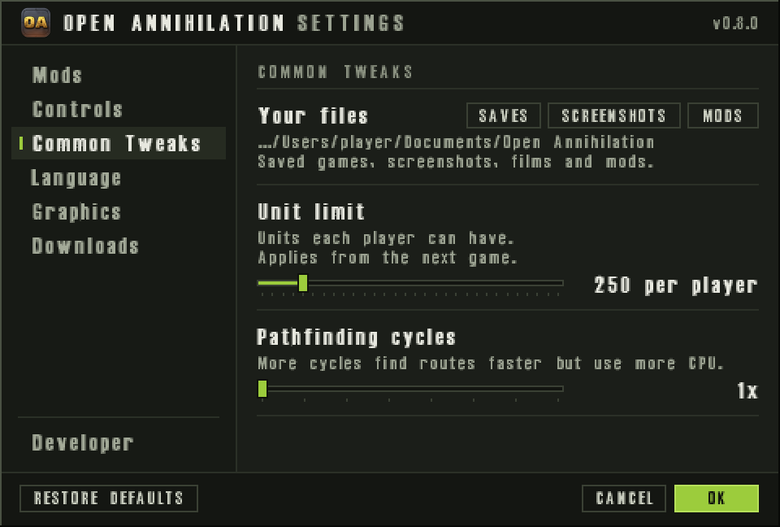

- **Your files** is not a setting: it shows where your saved games,
  screenshots, films, recordings and mods go, the Open Annihilation folder
  in your Documents folder unless you moved it. **SAVES**, **SCREENSHOTS**
  and **MODS** open those folders in the system's file manager. Films and
  the recordings of network games are in its `Films` and `Recordings`
  folders, which have no button. `Saves`, `Screenshots`, `Films` and
  `Recordings` each hold a folder for each mod, named after its id, and
  `default` for games without a mod. The installation guides say what each
  folder holds and how to move the folder
  ([macOS](installation/macos.md#where-it-keeps-its-files),
  [Windows](installation/windows.md#where-it-keeps-its-files),
  [Linux](installation/linux.md#where-it-keeps-its-files)).
- **Unit limit**, 50 to 1500 units per player in steps of 50 (a mod may
  allow more). By default it is the unit limit your Total Annihilation
  installation sets, or 250 where it sets none; a mod may give a default
  of its own. It applies from the next game: a saved game keeps the limit
  it was saved with, and a multiplayer game plays the host's. Raise it for
  bigger battles; lower it if a slow computer struggles late in a game.
- **Pathfinding cycles**, 1x to 8x, 1x by default, the game's own amount.
  It multiplies how much route-finding work the game does each tick, shared
  by every player. More cycles find routes faster, so units of a large
  army start moving sooner after an order, but use more of the processor.
  It applies from the next game, and a multiplayer game or a replay always
  plays at 1x. Raise it on a fast computer if large groups hesitate before
  they move.

Both sliders are locked during a game, and in a multiplayer game or a
replay they show "Set by the host".

## Language

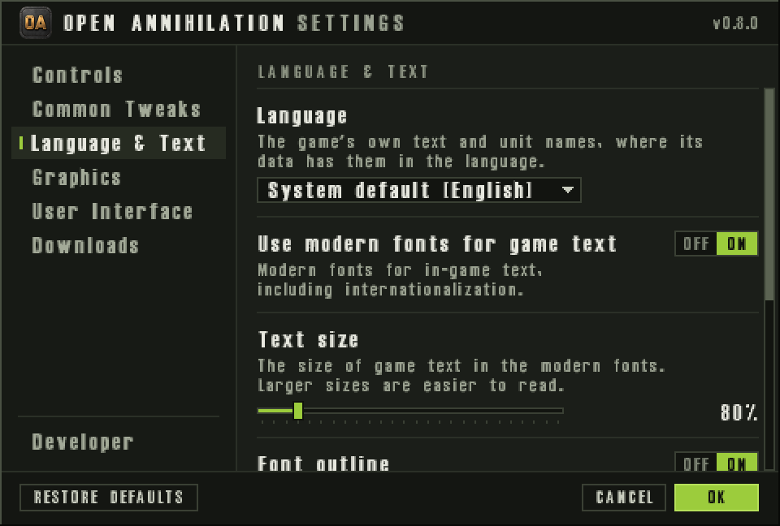

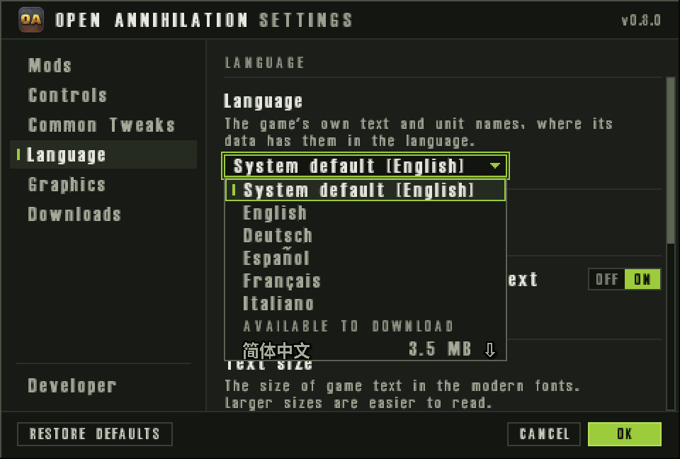

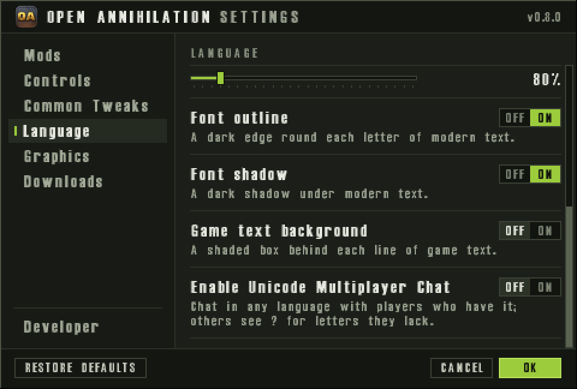

The Language section says which language the game's text is shown in and
how that text is drawn. None of these changes the game itself, so no game
locks them, and players in different languages play together.

- **Language**: System default, English, Deutsch, Español, Français or
  Italiano, each named in itself, and any installed language pack's language, named in itself. System default, the default, follows your
  operating system's preferred languages, and the list says which it chose,
  as "System default (English)". The game's own text and unit names show
  in that language wherever the game data has them; whatever it leaves
  untranslated stays in English. A change shows at once in what is drawn
  every frame and on the menu under the settings, and in other screens and
  panels as they open. Choose a language to play in one other than your
  system's. 3.1c's own command line, such as `open-annihilation german`,
  decides it for the run.
  A registry's list can offer further languages. They are listed under
  AVAILABLE TO DOWNLOAD, after the installed ones, each with its size:
  whole kB under 1,000,000 bytes, one decimal of MB under 100 MB, and whole
  MB from there on. A pack the OA team published shows that size and a
  download mark. A
  community pack shows "community", the share of the game it translates
  when the catalogue gives one, and its size. A pack from a registry that
  was added shows "not reviewed" where a community pack shows
  "community". A registry whose downloads are off shows "downloads off",
  and its language stays greyed. Choosing one from the open list starts
  its download at once, with no question, and the field shows how far it
  has got (" · waiting", " · 40%", " · installing", or " · failed", which
  choosing it again retries); the hint says "Downloads, then switches to
  it." The language applies when the pack arrives, with no restart. OK
  keeps the choice. Cancel restores the language the dialog opened with. A
  download already started still installs, and the game keeps the language
  it had. The arrow keys move among System default and the installed
  languages only.
  [Languages](languages.md) says what the game data and the language packs
  translate.
- **More in the Library…**, under Language on the main menu, opens the
  Library on its Languages tab, over the settings, for every language pack
  the registries offer ([the Library](library.md)).
- **Use modern fonts for game text**, On by default. The game's text is
  drawn in modern fonts, which hold the letters of many languages and stay
  sharp at any size, in place of the game's own 8-bit fonts. Turn it off
  for the game's original look. Simplified Chinese is drawn only in them
  once its pack is installed: choosing it turns the switch On, and it stays
  On, locked, "Set by the language", while Simplified Chinese is chosen.
- **Text size**, 50% to 300% of the game fonts' sizes in steps of 10%, 80%
  by default. It sizes the modern fonts, so it is locked while they are
  off: the game's own fonts have fixed sizes. Raise it on a large or dense
  screen, or whenever the text is hard to read.
- **Font outline**, On by default: a dark edge round each letter of the
  modern text.
- **Font shadow**, On by default: a dark shadow under the modern text.
- **Game text background**, Off by default: a shaded box behind each line
  of game text.
- **Enable Unicode Multiplayer Chat**, Off by default. Chat lines in a
  shared game are written in UTF-8, so that players can chat in any
  language: the machines of players who have it on read them as written,
  and the others get each letter their code page lacks as `?`. Lines that
  start with `+` or `.` stay commands, as in 3.1c. A language written
  outside the code page, as Simplified Chinese is, or whose pack asks for
  it, turns it On, locked, "Set by the language", while that language is
  chosen, and so does a mod profile
  that sets [ui.text-rendering](mods/standard-hacks/ui.text-rendering.md)
  `unicode`. It changes no game, so players with it on and off play
  together.

The last three keep text readable over a busy battlefield. Turn on Game
text background where the text still gets lost; turn the outline and
shadow off for plainer text. Each takes effect at once.
[ui.text-rendering](mods/standard-hacks/ui.text-rendering.md) shows where
the game draws its text and how the modern fonts draw it.

## Graphics

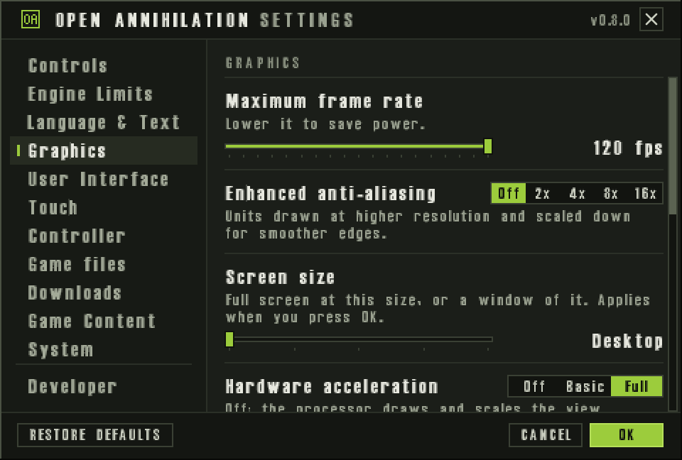

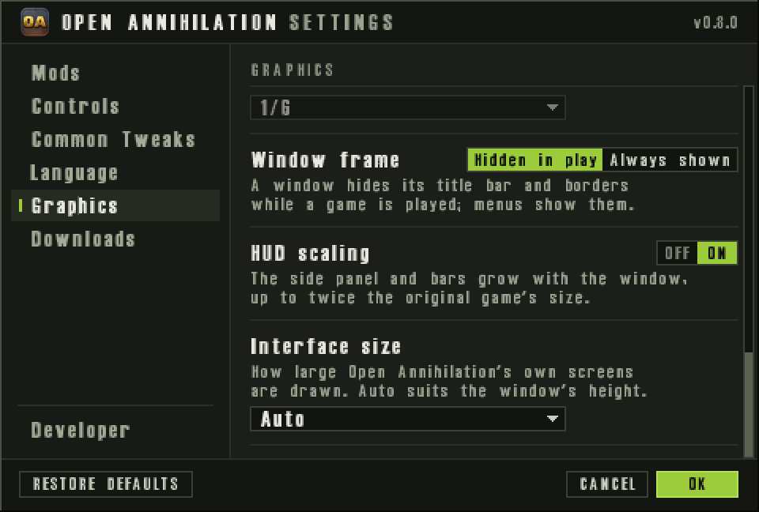

- **Maximum frame rate**, 30 to 120 frames a second in steps of 5, 120 by
  default. It caps how many pictures the game draws a second; the game
  itself plays at the same speed whatever it is. Lower it to save power,
  heat or battery, or to keep a slow computer's frame rate steady. It takes
  effect at once.
- **Enhanced anti-aliasing**, Off, 2x, 4x, 8x or 16x, Off by default. It
  smooths the jagged edges of units. While the processor draws the
  battlefield (Hardware acceleration Off or Basic), units are drawn at that
  many times the resolution and scaled down; 8x and 16x need a fast
  processor. While the graphics card draws it (Full), the card draws the
  whole battlefield with that many samples across each pixel, as far as
  the window's size and the card's memory allow, and the hint says when it
  draws fewer. Raise it for smoother edges if the frame rate holds.
- **Screen size**, Desktop or any size the display offers from 640x480
  up, such as 2560x1440 or 3840x2160 on a 4K monitor and 3440x1440 on an
  ultrawide, Desktop by default. It applies when you press OK, on the menus
  and during a game, which carries on as it was. The sizes are those of
  the display the game's window is on. In full screen on Windows, and on
  Linux with an X server of its own, they are the display's full-screen
  modes; otherwise those that fit the desktop, with 640x480, 800x600,
  1024x768, 1280x1024 and 1600x1200 where they fit it. Sizes are listed
  once each, whatever their refresh rates, the narrower first, up to 8192
  on a side. On a high-density display, such as a Mac's Retina display,
  they are in the desktop's points, as the system lists them, so that each
  one fits the screen.
  - In a window, the window takes the size at once, moved back onto the
    display where the new size would take it off. Resize the window by its
    edges and it keeps the size you give it: the setting then shows that
    size, or **Custom** where the display offers no such size, and
    choosing a listed size snaps the window back to it. Desktop leaves a
    window as it is.
  - In full screen, Desktop shows the screen at the desktop's own size and
    mode. On Windows, and on Linux with an X server of its own, another
    size switches the screen to the display's mode of that size, at the
    desktop's refresh rate where the display has it, as the original game
    did; Windows puts the desktop back as the game leaves full screen, is
    switched away from or ends. On macOS, on Linux under Wayland (and X11
    programs within a Wayland session), in Steam's Game Mode, and wherever
    the display has no mode of the size, the screen keeps the desktop's
    mode: the game draws at the size and scales the picture to the screen,
    letterboxed or in whole steps as **Menu scaling** says. The pointer in
    the black bars around the picture rests on its edge, where it scrolls
    the battlefield. A size chosen in full screen is the window's size
    once you leave full screen.

  A size the display no longer offers, as when another monitor is
  connected, starts at Desktop; the setting keeps it for when the display
  offers it again. The options' Screen Size, under Visuals, lists the same
  sizes, shows Custom for a window sized by hand, and applies the size
  chosen when the options close with OK; their Restore Default sets it back
  to its default. Choose a size for the period look, for an old monitor, or
  so that a slow computer has fewer pixels to draw.
- **Hardware acceleration**, Off, Basic or Full, Full by default. It says
  how much of the drawing the graphics card does:
  - **Off**: the processor draws and scales every frame, as the game always
    did.
  - **Basic**: the graphics card scales and composes the frames, so the
    picture fills the window evenly; the processor still draws them.
  - **Full**: the card also draws the battlefield, smoothed at every zoom,
    and Maximum zoom out's Automatic reaches a sixth of the game's scale,
    three times as far as the processor's drawing allows. It does not yet
    draw the small lens that a shot of a weapon with render type 2 makes of
    the ground under it; Basic and Off do.

  The card is used only where it can do the work and the computer has at
  least 2 GB of memory. Where Full cannot run, Basic draws in its place;
  where neither can, the processor does. The row's two status lines say
  which is in use and, if not the one chosen, why. At each start the game
  first has the card draw a few known patterns and reads them back, and
  it does not use a card that draws them wrongly. A graphics driver that
  stopped the game or failed twice in a row is passed over at later starts
  (once is enough on Linux and on Windows XP, where such a stop can halt
  the whole computer), and the main menu says so once. Setting it to Off
  and back, or Restore defaults, tries the card again. Each change takes
  effect at once, except during a multiplayer game or a replay: there Off
  applies at once, and Basic or Full from the next game. Leave it at Full
  for the smoothest picture and zoom; set it to Basic or Off if the
  graphics card or its driver misbehaves.
- **Vertical sync**, Off by default. Each frame waits for the display, so
  no frame tears, and the frame rate keeps just below the display's. Turn
  it on if you see tearing lines when the view scrolls. It takes effect at
  once, keeps its value for the length of a multiplayer game or a replay,
  and shows "Not available here" where the renderer cannot offer it.
- **Menu scaling**, Sharp, Whole steps or Unfiltered, Sharp by default. It
  says how the menus, drawn at 640x480, fill the window, and how a game in
  full screen drawn at a Screen size of its own fills the screen, and takes
  effect at once.
  - **Sharp**: as large as the window holds, every pixel as wide as the
    next, where the graphics card can.
  - **Whole steps**: the largest whole-number scale that fits; the menus
    are smaller, with a black border, but every pixel is square.
  - **Unfiltered**: they fill the window as the game always drew them.

  Choose Whole steps for the crispest pixels, or Unfiltered for the
  original look.
- **Native pixel density**, Off by default; it applies from the next start.
  The window opens at the display's own pixel density, the Retina
  resolution on a Mac, in place of the window system's, so the picture can
  use every pixel of a high-density display. It needs at least 2 GB of
  memory, and a run started with `--no-hardware-acceleration` keeps it off.
  Turn it on for a sharper picture on such a display, if the frame rate
  holds. It is always on on an iPhone and an iPad.
- **Explosion flash**, Off, Reduced or Full, Full by default. Every
  explosion lights up the ground around it for under a second, brightest at
  its centre and nearly white where flashes overlap, as the game always
  drew it; when a unit is destroyed each piece that bursts flashes, so a
  big battle can light the battlefield white. Reduced lights it at half
  strength; Off draws no flash at all. A mod can design its explosions to
  flash less ([ui.explosion-flash](mods/standard-hacks/ui.explosion-flash.md)),
  and the lower of the two is drawn, so a mod can never make them flash
  more than you chose. It changes only what your screen shows, never the
  game, and takes effect at once, in a multiplayer game or a replay too.
  Choose Reduced or Off if flashing light is uncomfortable for you.
- **Zoomed out units**, Rendered or Dots, Rendered by default; Icons is
  shown but cannot be chosen yet. It says how units are drawn when the
  view is zoomed out farther than After zoom. Rendered draws every unit,
  wreck and shot as at any zoom, however far out the view goes: on a large
  map zoomed out to the whole map that takes a fast processor, and memory
  for every map pixel in view, and where a computer cannot spare an eighth
  of its memory for that, its units are drawn as dots there. Dots draws
  each unit as a small square of its owner's colour, framed while
  selected, with no health bars; a frame of the whole map then costs no
  more than one at half scale. Clicks, drags and orders work either way,
  and a click on a unit's dot, or where it would be, picks the unit. It
  takes effect at once.
- **After zoom**, 1/2, 1/3, 1/4, 1/6, 1/8, 1/12 or 1/16, 1/6 by default,
  locked ("Needs Dots") while Zoomed out units is Rendered. Farther out
  than this share of the game's scale, units are drawn as dots; closer in,
  as models. 1/6 is about where units stop being told apart. With Maximum
  zoom out at Automatic the view never goes farther out than 1/2, or 1/6
  with Full hardware acceleration, so choose a farther Maximum zoom out to
  see the dots.
- **Window frame**, Hidden in play or Always shown, Hidden in play by
  default. In a window, Hidden in play hides the window's title bar and
  borders while you play a game, so that only the battlefield shows, and
  brings them back while the game menu, or a panel it opens, is up and on
  every other screen, where the window can be moved and closed. Always
  shown keeps them on every screen. The battlefield keeps its size either
  way, and full screen has no frame to hide. It takes effect at once.
- **HUD scaling**, Off or On, On by default. On, the side panel with its
  minimap and build menu, and the top and bottom bars of a game, grow with
  the window up to twice the original game's size, as on a 1280x960
  window, and the battlefield takes the rest. Off, they keep the original
  game's 640x480 size on every window, and the battlefield takes all the
  room they leave. Clicks and the minimap follow either way, and at
  640x480 the two look the same. The touch controls keep their own sizes.
  It takes effect at once, in a game too.
- **Interface size**, Auto, 100%, 150%, 200%, 300% or 400%, Auto by
  default: how large Open Annihilation's own screens are drawn. These are
  the settings, their notices and questions, the Library, the map browser,
  GET MAP in the battle room, the Add registry window, the check that you
  are a person, the battle room's player cards and the UI kit gallery. The 3.1c screens
  keep Menu scaling, the game's text keeps Text size and the side panel and
  bars keep HUD scaling.
  - **Auto** draws them at the window's height in pixels divided by 720,
    rounded: 1x below 1080 lines, 2x at 1080 and 1440, 3x at 2160, and
    never below the display's own pixel density, so a phone keeps the
    smallest layout.
  - **A size you choose** is used as far as the smallest layout still fits
    the window, so 400% on a 1920x1080 window draws at 3x. 150% is offered
    only while Use modern fonts for game text is On, because the game's
    own fonts draw only at whole steps; turning the modern fonts off while
    it is chosen sets 100%.

  At that size each screen lays itself out for the room the window leaves
  it: the Compact layout, the 480x324 dialog of earlier versions, while
  fewer than 960x540 points are left; Regular, 720x486, from 960x540; and
  Large, 960x600, from 1280x720. So at 1920x1080 Auto draws Regular at 2x,
  and at 2560x1440 Large at 2x. A 640x480 window draws exactly as earlier
  versions did. In a match the settings sit beside the side column, at no
  more than its scale, and take their layout from the room beside it: a
  1920x1080 match shows Compact at 2x where the menus show Regular. It
  takes effect when you press OK, and is never locked. Choose a larger
  size if OA's screens are small to read on a large display, or a smaller
  one to see more of a list at once.

Some computers start with other defaults, which Restore defaults puts back
and which a value you choose always replaces:

- a **light computer**, one with a single processor, a processor without
  SSE2 (a Pentium III or an Athlon XP) or less than 512 MB of memory,
  starts at 800x600 (640x480 when its desktop is smaller), at 60 frames a
  second, with Enhanced anti-aliasing off;
- a **Raspberry Pi** starts at 60 frames a second;
- a **Steam Deck** starts at its screen's rate, 60 frames a second on the
  LCD model and 90 on the OLED, with the touch controls' Control size at
  Larger ([Steam Deck](installation/steam-deck.md)).

## Touch

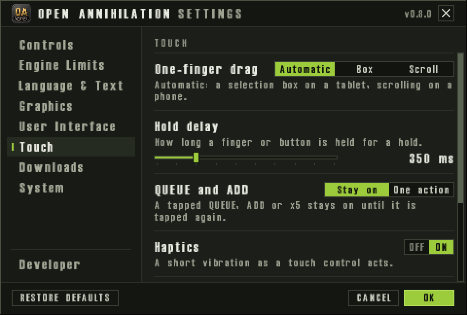

The Touch section shows while the game has touch controls: always on an
iPhone and an iPad, on a touch screen once a finger touches it, and with
`--touch-controls`. Each setting takes effect at once.

- **One-finger drag**, Automatic, Box or Scroll, Automatic by default:
  what a finger dragged across the battlefield does. Automatic draws a
  selection box on a tablet and scrolls the map on a phone. A hold then a
  drag always draws a box, and two fingers always scroll.
- **Hold delay**, 250 to 700 ms in steps of 50, 350 ms by default: how long
  a finger stays down before it counts as a hold, which opens the order
  menu or a control's help. Raise it if holds start when you mean to tap.
- **QUEUE and ADD**, Stay on or One action, Stay on by default: whether a
  tapped QUEUE, ADD or x5 stays on until it is tapped again, or turns off
  after the next order or selection.
- **Haptics**, On by default: a short vibration as a touch control acts.
- **Left-handed layout**, Off by default: the minimap and the thumb
  controls on the right, the orders on the left.
- **Control size**, Standard, Large or Larger, Standard by default: how
  large the touch controls are drawn; the game's own screens keep their
  size.

[Touch controls](touch-controls.md#touch-settings) describes them with the
gestures they change.

## Controller

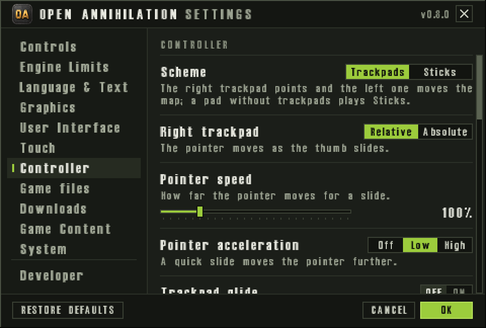

The Controller section shows once a gamepad has been used in this run.
Each setting takes effect at once.

- **Scheme**, Trackpads or Sticks, Trackpads by default. With Trackpads
  the Steam Deck's right trackpad points and the left one moves the map;
  with Sticks the right stick points and the left one moves the map. A
  gamepad without trackpads plays Sticks.
- **Right trackpad**, Relative or Absolute, Relative by default: the
  pointer moves as the thumb slides, or each point of the pad is a point
  of the view.
- **Pointer speed**, 50% to 300%, 100% by default; **Pointer
  acceleration**, Off, Low or High, Low by default, so that a quick slide
  moves the pointer further; and **Trackpad glide**, Off by default, which
  keeps the pointer moving after a quick flick. Change them if the pointer
  feels too slow, too fast or hard to place.
- **Right stick**, Zoom, Pointer or Nothing, Zoom by default: Zoom zooms
  the view about the pointer and, while building, turns the build page
  with a flick.
- **Magnetism (stick pointer)**, On by default: the stick's pointer
  settles on a lone unit near it.
- **Gyro pointer**, Off by default, or on while the right pad is touched,
  while the right stick is touched, or always, and **Gyro speed**, 50% to
  400%, 100% by default: turning the controller fine-tunes the pointer.
- **Haptics**, Off, Light or Strong, Light by default: small ticks and
  bumps felt through the controller.
- **Button prompts**, Automatic by default, or Steam Deck, Xbox,
  PlayStation, Nintendo or Off: the style of the button pictures the
  controls and rings show. Choose one if Automatic picks the wrong style
  for your gamepad.
- **Left-handed**, Off by default: the two sides' roles swapped, so the
  left pad points.
- **Control size**, **Hold delay** and **QUEUE and ADD**, the same settings
  as in Touch.

While the gamepad reaches the game through Steam Input, the section starts
with a notice in amber: Steam then hands the game the trackpads and back
grips as a mouse and keys, so turn Steam Input off for Open Annihilation to
use them here. [Gamepad controls](controllers.md#controller-settings) gives
each setting's choices and default, and what every input does.

## Game files

On an iPhone or an iPad, the main menu's settings have a Game files
section for the Total Annihilation files copied onto the device:

- **Installed**: what is installed, its size and the free space, and
  **Manage…**, which opens the Game files screen to check, add, replace or
  remove the files.
- **Include in device backups**, Off by default: the game files go into
  the device's backups too. They are large, and can always be copied
  again.
- **Where the files are**: the folder that holds them.

[Game files](game-files.md#managing-the-game-files) describes managing
them.

## Downloads

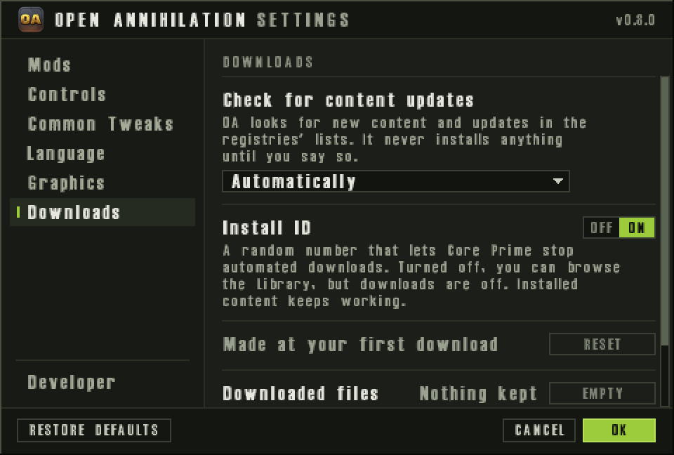

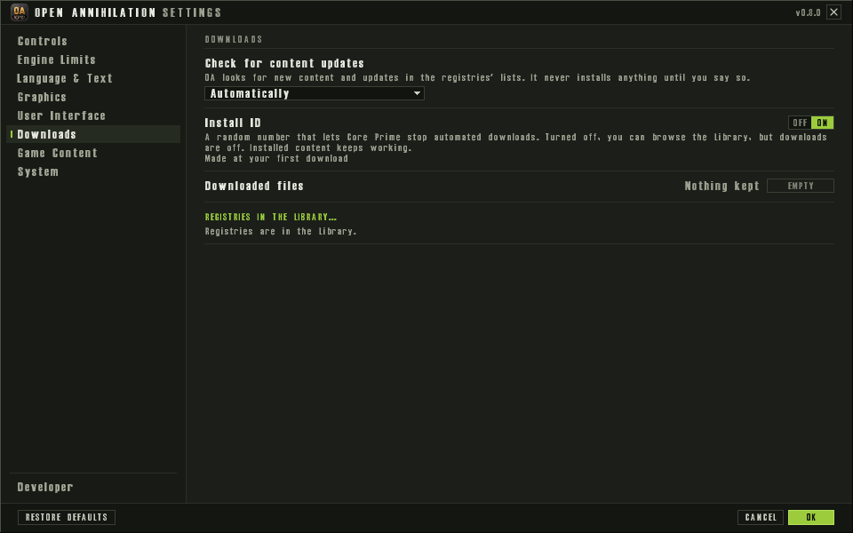

Downloads says when Open Annihilation looks for new content, holds the
install ID a registry asks for, keeps the files downloads leave behind, and
lists the registries content comes from. [Downloads and privacy](downloads.md)
explains each of them, and what a download sends and records.

- **Check for content updates**, Automatically, Only when I open the
  Library or Never, Automatically by default: when OA fetches the
  registries' lists, which say what can be downloaded and which updates
  wait. Automatically fetches a registry's list as the game starts when the
  list it has is more than 6 hours old, and when the Library opens; Only
  when I open the Library, only then; Never, only when you ask
  ([when OA checks](downloads.md#when-oa-checks-for-content)). Whichever
  you choose, OA installs nothing until you press a button. It takes
  effect when you press OK.
- **Install ID**, On by default: a random number that lets Core Prime stop
  automated downloads, made at your first download from its registry.
  Turned off, you can browse the Library, but downloads from that registry
  are off; installed content keeps working. The row under it shows the ID
  in part, as "7f3a90d2 · · · c91e", or "Made at your first download"
  before one is made, or "Off"; **RESET** replaces the ID with a new random
  one at once. Each registry that asks for an install ID has its own,
  labelled "Install ID · *registry*" when there is more than one. The
  switch takes effect at OK; RESET acts at once, and Cancel does not undo
  it.
- **Downloaded files**: how much the download folder keeps for resuming and
  repairs, or "Nothing kept". **EMPTY** removes those files at once; it is
  greyed while nothing is kept, or while a download is using them.
- **Registries**: which registries are on, "Core Prime only", "2 on of 3"
  or "None", and **MANAGE…**, which shows the Registries part:

The Registries part lists Core Prime's registry, which is built in and can
be turned off but not removed, then each registry you added, with its
address, how many packages it lists and "not reviewed". Each has a switch;
an added registry also has **REMOVE** ("Removed when you press OK", with
**UNDO**) and **ADD MIRROR…**. **ADD REGISTRY…** takes Restore defaults'
place in the footer. The switches and removals take effect at OK, and
Cancel puts them back; a registry or mirror you add is added at once.
**‹ DOWNLOADS** goes back. [Registries](downloads.md#registries) explains
adding one, mirrors and what "not reviewed" means.

During a game RESET and EMPTY are locked ("Locked during a game."), and so
are ADD REGISTRY… and ADD MIRROR… ("Choose from the main menu."); the rest
can still change.

## Developer

The Developer section sits at the foot of the column, under the divider.

- **Enable Developer Mode**, Off by default. It lets you change the
  standard hacks of the mod being played, or of 3.1c without a mod, without
  editing the mod's `oamod.yaml`: turn a hack on or off and set its values,
  to try them before writing them into a profile. Off, the game plays the
  profile as it ships, and your changes are kept for when you turn it on
  again. On, they apply: a change to a view hack, which changes only what
  you see, at once, even in a running match, and a change to a sim hack,
  which changes the game itself, from the next match. A changed sim hack
  changes the profile's sim hash, as writing it into `oamod.yaml` would,
  so a game saved with it loads only with the same changes, and every
  player of a network game must have them. While it is on, a network
  game's battle room is told so.
- **Show performance statistics**, Off by default: the frame and tick
  times over the battlefield, the renderer in use, and a line saying
  whether the game shows in a window, full screen on the desktop's mode or
  full screen at a mode of its own (exclusive), the size it draws the
  battlefield at, and the display's size, refresh rate and scale (2x on a
  Retina display), as the `+stats` console command shows them. It works whether or not Developer Mode is
  on, and takes effect at once.
- **UI kit gallery** is not a setting: **SHOW** opens the gallery over the
  settings, every part of Open Annihilation's own screens in each of its
  states, at the size and layout the window gives them now (see Interface
  size, in [Graphics](#graphics)). **CLOSE** goes back to the settings.
  It is for checking how OA's screens look, and for people building
  them ([the UI kit](extensions/ui-kit.md)).

Under them the section lists every standard hack, grouped by area, with a
switch for each and a control for each of its values. **Show Active Only**
shows only the hacks that are on, and **Restore profile values** clears
every change. Developer Mode keeps its changes for each mod apart. Restore
defaults turns it off but keeps the changes.

The hacks themselves are described in [Mod support](mods/README.md):
[Developer Mode](mods/README.md#developer-mode) in full,
[the table of every standard hack](mods/README.md#every-standard-hack), and
a page for each in [standard-hacks](mods/standard-hacks/).

## For one run: the command line

These options set a setting for one run without changing what is kept.
The row then shows "Set on the command line", and the Mods section "The
command line chose this run's mod."

| Option | Setting | For the run |
|---|---|---|
| `--max-fps N` | Maximum frame rate | N frames a second, 30 to 1000, or 0 for no limit |
| `--hardware-acceleration=off`, `=basic` or `=full` | Hardware acceleration | that level; `--hardware-acceleration` alone is Full |
| `--no-hardware-acceleration` | Hardware acceleration | Off |
| `--native-density` | Native pixel density | On |
| `--mod-dir PATH` | Mods | plays the mod folder at `PATH` |
| `--base-game` | Mods | plays 3.1c without the mod you chose |
| a language's name, as `german` | Language | that language, as 3.1c's command line names it |

Two more change what the settings show: `--touch-controls` turns the touch
controls on, and with them the Touch section, and `--user-folder PATH`
puts Your files' folder at `PATH`. `SDL_RENDER_DRIVER=software` in the
environment has the processor draw every frame, and Hardware acceleration
then says it is not in use.

## Where the settings are kept

The settings are kept in your preferences file, with the game's own
options. The installation guides say where it is
([macOS](installation/macos.md#where-it-keeps-its-files),
[Windows](installation/windows.md#where-it-keeps-its-files),
[Linux](installation/linux.md#where-it-keeps-its-files)), and
[user preferences](../src/platform/preferences/README.md) lists every key.
A setting you have never changed is not written, and follows its default.
To turn Hardware acceleration off for good without starting the game, for
a graphics driver that stops it, set
`open-annihilation.hardware-acceleration` to `off` in that file; `basic`
and `full` name the other levels.

`--preferences-file FILE` reads and writes the settings in `FILE` instead.
Its defaults are then the game's own behaviour on every computer, so that
a check plays alike everywhere: Escape opens the game menu, Hardware
acceleration and Use modern fonts for game text all start Off, the
language is English, the unit limit is 250 (or the mod's own default when
a mod is played), and no computer has defaults of its own.
[The settings' module](../src/ui/engine-settings/README.md) describes the
dialog and every setting for developers.
